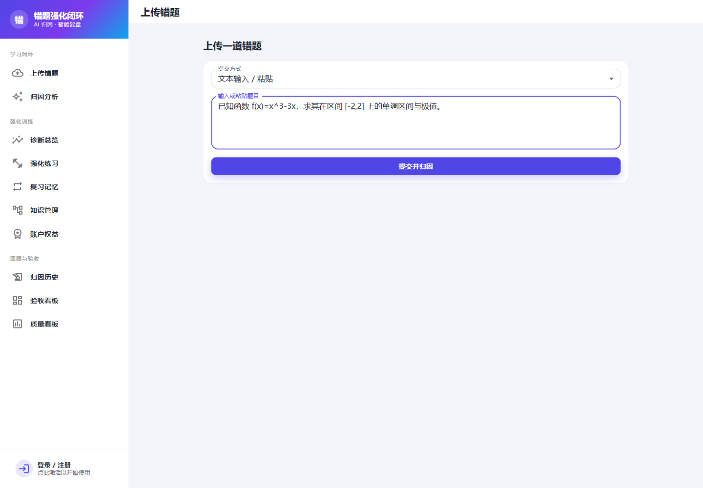
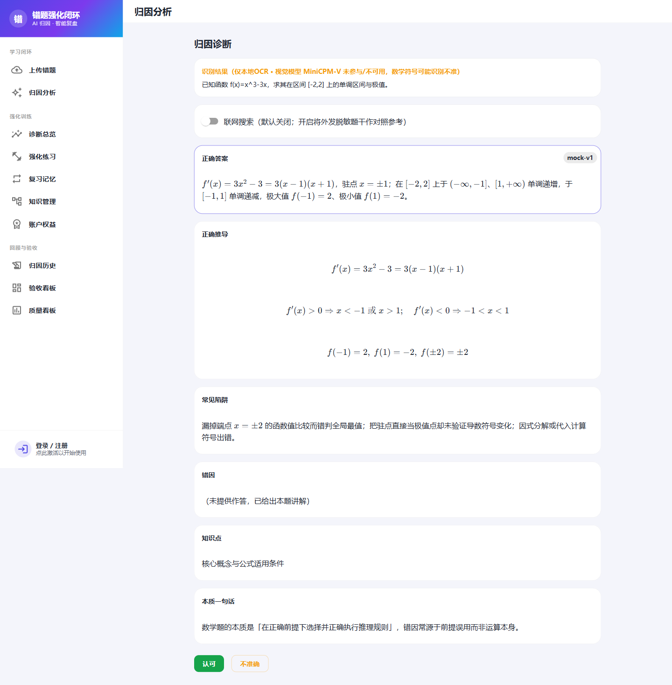
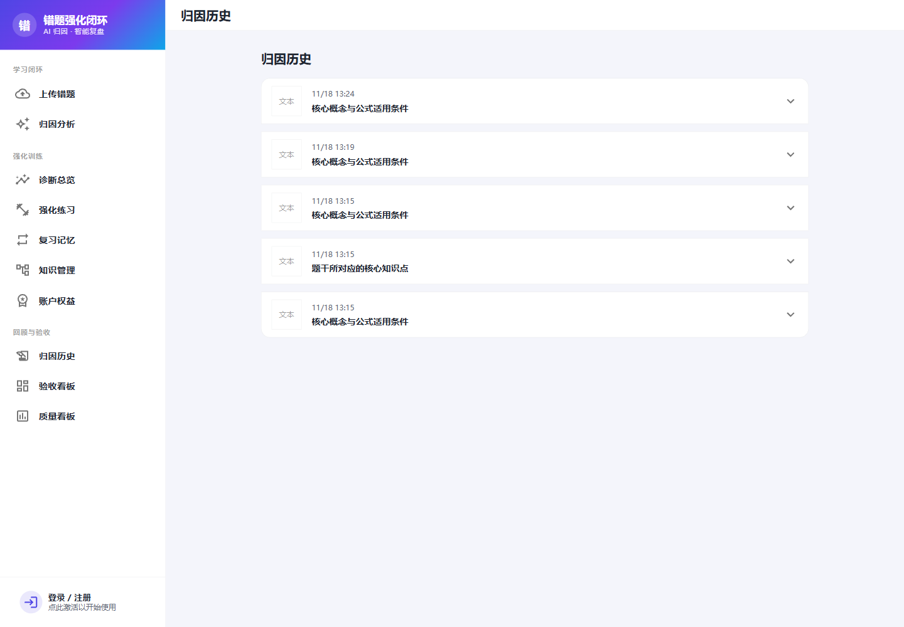
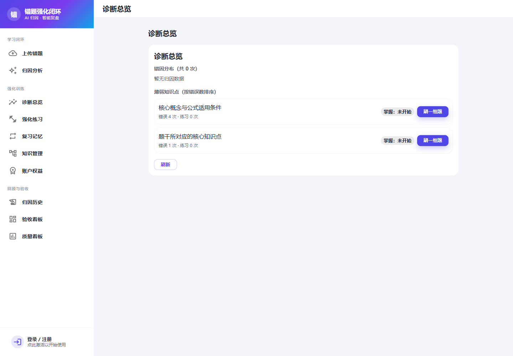
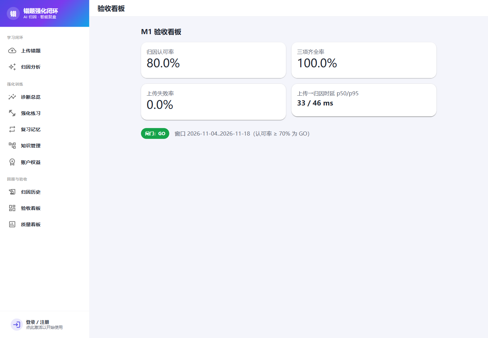
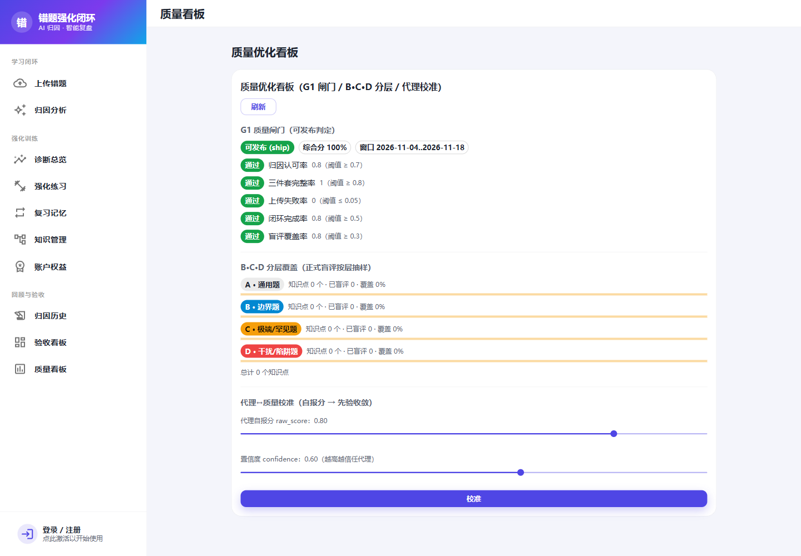
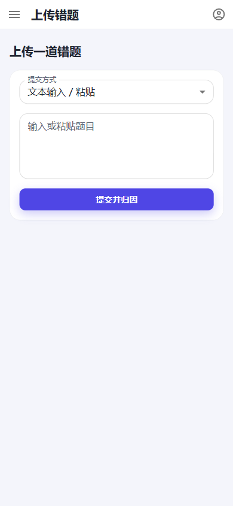
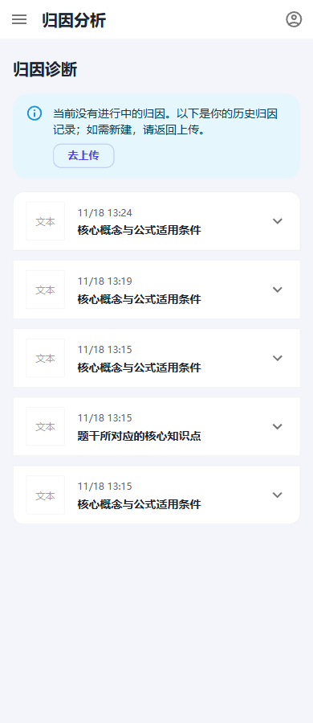

<div align="center">

# 错题强化闭环 · AI Correction

**拍照 / 粘贴一道错题 → AI 定位错因、锚定知识点、讲透本质 → 练习 · 复述 · 验证，形成完整强化闭环。**

> 验证最危险假设链第一步：**AI 归因是否可信**（R2 信任障碍）。
> v0.1 严格范围防火墙：仅实现 R01 上传 + R02 归因 + R03 认可/追问 + Infra-0 最小地基；R04–R08、可视化、图谱渲染均不在本版范围。


[界面实拍](#-界面实拍) · [特色](#-为什么是错题强化闭环而不是又一个拍照搜题) · [知识图谱进度](#-错题知识图谱--思维导图愿景与当前进度) · [功能](#-核心功能) · [架构](#-架构) · [部署](#-免费部署) · [模型验收](#-模型验收与honesty) · [文档](#-文档索引)

</div>

---

## ✨ 核心功能

| 环节 | 能力 | 实现要点 |
|---|---|---|
| 📷 **上传** | 拍照 / 图片 / 文本粘贴三入口 | 本地 RapidOCR（文本 + 公式）+ 视觉大模型双通道；拒识校验层拦截「非题目」防伪造题干 |
| 🧠 **归因** | 错因分类 · 知识点锚定 · 本质讲解 | 统一 `LlmProvider` 抽象；单模型 / 本地多模型编排 / 云端 API 三策略；题库 RAG 参考块（绝不虚构） |
| ✅ **认可 / 追问** | 用户评分 + 多轮追问验证 | 认可率 M1 闸门；追问轮次上限与诚实降级 |
| 🔁 **强化闭环** | 同类题练习 · 复述本质 · 验证掌握 | `loop_id` 贯穿五步；间隔复习与知识点掌握度沉淀 |
| 🎛️ **管理后台** | 配置覆盖 · 知识点库 · 归因调试台 | 独立 `x-admin-key` 授权面，与终端用户卡密门禁隔离 |
| 📊 **质量治理** | G1 闸门 · 灰度发布 · 埋点看板 | K1.4 灰度/cohort + kill-switch；M1 认可率、上传失败细分看板 |

> ⚠️ **诚实声明**：v0.1 是**线下内测体验版**，`attribution` 质量尚未通过正式 G1 验收闸门（见下方模型验收），请勿将内测数据当作正式基线。下列截图来自**独立演示环境**（mock 模型 + 虚构题目，非真实用户数据）。

---

## 📸 界面实拍

> 从「拍一道题」到「看板验收」的完整界面。全部为干净 demo 环境截图：虚构题目 + mock 归因，无真实用户数据。

<table>
  <tr>
    <td width="50%" valign="top">
      <a href="docs/screenshots/01-upload.png"></a>
      <p align="center"><b>① 上传错题</b><br/>拍照 / 图片 / 文本粘贴三入口，草稿自动保存</p>
    </td>
    <td width="50%" valign="top">
      <a href="docs/screenshots/02-attribution.png"></a>
      <p align="center"><b>② AI 归因诊断</b><br/>正确答案 · 推导 · 陷阱 · 错因 · 知识点 · 本质一句话</p>
    </td>
  </tr>
  <tr>
    <td width="50%" valign="top">
      <a href="docs/screenshots/03-history.png"></a>
      <p align="center"><b>③ 归因历史</b><br/>每道题的归因结果持久留存，随时闭环回看</p>
    </td>
    <td width="50%" valign="top">
      <a href="docs/screenshots/04-reinforce-diagnosis.png"></a>
      <p align="center"><b>④ 强化训练 · 诊断总览</b><br/>错因分布 + 薄弱知识点按错误数排序，一键练同类题</p>
    </td>
  </tr>
  <tr>
    <td width="50%" valign="top">
      <a href="docs/screenshots/06-dashboard.png"></a>
      <p align="center"><b>⑤ M1 验收看板</b><br/>认可率 / 三项齐全率 / 上传失败率 / 时延 p50·p95 + 闸门</p>
    </td>
    <td width="50%" valign="top">
      <a href="docs/screenshots/07-quality.png"></a>
      <p align="center"><b>⑥ 质量优化看板</b><br/>G1 闸门 · B·C·D 分层盲评 · 代理↔质量校准</p>
    </td>
  </tr>
  <tr>
    <td width="50%" valign="top">
      <a href="docs/screenshots/08-mobile-upload.png"></a>
      <p align="center"><b>⑦ 移动端 PWA · 上传</b><br/>响应式抽屉导航，手机浏览器可安装</p>
    </td>
    <td width="50%" valign="top">
      <a href="docs/screenshots/09-mobile-attr.png"></a>
      <p align="center"><b>⑧ 移动端 PWA · 归因</b><br/>归档与诊断在窄屏下同样可用</p>
    </td>
  </tr>
</table>

<details>
<summary>更多截图（强化练习 / 移动端全部）</summary>

- [强化练习](docs/screenshots/05-reinforce-practice.png)

</details>

---

## 🌟 为什么是「错题强化闭环」，而不是又一个拍照搜题

市面上拍照搜题工具止步于「给答案」。本项目把重心放在**可信归因 → 可验证掌握**的完整链路，并刻意把「诚实」做成一等公民：

| 特色 | 说明 | 普通搜题工具 |
|---|---|---|
| 🧭 **一条 `loop_id` 串起五步** | 上传 → 归因 → 认可/追问 → 练习 → 复述验证，全链路可追溯 | 一次性问答，无闭环 |
| 🎯 **归因三段式 + 六卡片** | 错因分类、知识点锚定、本质一句话，另附正确答案 / 推导 / 常见陷阱 | 只给答案与解析 |
| 🛡️ **拒识 + 联网默认关闭** | 拒识层拦截「非题目」防伪造题干；联网搜索默认关闭，开启才外发脱敏题干 | 全量上传、默认联网 |
| 🔍 **RAG 只引用不虚构** | 题库参考块走真实哈希嵌入检索，检索为空就如实标注 `empty`，绝不编造出处 | 常有虚构参考 |
| 📐 **公式原生渲染** | KaTeX 渲染推导过程，数学 / 物理符号可读 | 纯文本公式 |
| 📊 **质量治理可视化** | M1 认可率闸门 + G1 分层盲评 + 代理校准，指标口径全部落文档 | 无质量闭环 |
| 📱 **PWA + 双部署** | 手机可安装、拍照顺手；Netlify 静态 PWA / HF 全栈容器两套免费配方 | 多为单一形态 |

---

## 🗺️ 错题知识图谱 / 思维导图：愿景与当前进度

> 这是产品规划里最容易被误解的一块——**设计意图很明确，但当前尚未打通**。下面把「产品愿景」与「代码实况」分开陈述，绝不把规划写成已交付。

### 🎯 产品愿景（设计意图 · P2 / M7）

项目早期叫「思维导图产品」，后来做了一次**载体纠偏**：导图从产品目的降级为**可选可视化外壳**，诊断与强化才是内核。但这个外壳不只是好看，它要解决一个具体问题——

> **「一类题都错在同一片区域」**：以学科知识体系为骨架，节点 = 知识点、边 = 前置/包含/关联关系，节点颜色 = 掌握度、大小 = 错误频次。图谱的价值是**暴露根因簇**——三个看似无关的错点，可能共同指向一个前置概念缺失。

用户设想的交互（即本节的细节）：**在导图上点选某个知识点 → 下钻到该知识点下的错题列表 → 一键发起针对性练习**，让散落的错题在空间维度上被重新组织。

- **优先级与归属**：知识图谱 `R18` 定档 **P2 / M7**（路线图第 9–12 月）；思维导图 `R19` 已被裁决**并入 R18 作为一个视图模式，不独立立项**。
- **硬前置**（规划明确，也是真正的成本大头）：`R09` 错因聚合就绪 + **学科知识体系 v1（知识树 / 前置关系表）已构建** + `R10` 薄弱点上线。规划特别注明「图谱渲染只是零头，**体系构建才是成本大头**」。
- **对外叙事闸门**：P1 阶段「不得承诺知识图谱」；P2 也仅在 R18 上线且知识体系覆盖达标后才可谨慎承诺。

### 📊 当前开发进度（诚实标定 · 截至 2026-11-18）

规划文档把 R18 的状态记为「**已通电（未过闸门验证）**」（commit `d36efbe` / `d74114b`）。代码侧核查后，逐项进度如下：

| 能力项 | 状态 | 证据 / 说明 |
|---|---|---|
| 后端共现图算法 `getKnowledgeGraph` | ✅ 已落地（含单测） | `apps/api/src/services/knowledgeService.ts:112-152`、`models/attributionModel.ts:165-174` |
| 前端 SVG 环形共现图渲染 | ⚠️ 骨架已落地 | `apps/web/src/components/panels/KnowledgePanel.tsx:66-134`，手写 300×300 SVG（非 d3/echarts） |
| 前端页面与路由 / 权益门 | ✅ 已落地 | `pages/KnowledgePage.tsx`、`App.tsx:30`、`AppShell.tsx:67` |
| API 端点 `GET /learn/graph` 与客户端接线 | ✅ 已接通 | `routes/practiceRoutes.ts:315-323`、`api/client.ts:589-591` |
| R17 自定义知识点增 / 查 | ✅ 已落地（与图谱不联动） | `services/knowledgeService.ts:31-52`、`models/customKpModel.ts` |
| **图谱数据源 `knowledge_point_id`** | ❌ **断链（根因）** | 归因写库恒为 `null`（`attribution/attributionService.ts:305,389`），而图谱 SQL 要求 `IS NOT NULL`（`attributionModel.ts:170-171`）→ 真实用户图谱节点**恒为空** |
| 节点显示知识点文本 | ❌ 未接通 | `knowledgeService.ts:125` 直接拿 `kp_key` 充当文本，图上显示 `kp_001` 这类 id |
| **「导图上点知识点 → 选错题」** | ❌ **未实现** | 节点无点击事件、无 `selectedKp` 状态；**不存在**「按知识点列错题」的后端端点 |
| 权益门一致性 | ⚠️ 待修 | 页面用 `custom_kp` 解锁，但 `/learn/graph` 要 `knowledge_graph` |
| G8「可视有用」闸门 | ❌ **未判** | 规划 §11.3 明确 G8 等尚未判；`R09` 覆盖率、`R14` 掌握状态等前置未达阈值 |

> **一句话结论**：`R18` 目前是「**后端算法 + 前端原型 + 单测**」齐备、但**端到端数据链断开**的骨架——真实用户打开「知识管理」会看到空图；「在导图上通过知识点选择错题」这个具体场景**尚未实现**，属于 P2 目标而非现状。补齐需要三件事：① 归因写库时把 `knowledge_point` 文本映射成 `kp_key`；② 图谱节点可点击 + `selectedKp` 状态；③ 新增「按 kp_key 列出错题」端点 + 前端筛选列表。

> 📌 **与顶部范围防火墙的关系**：本页开头「v0.1 可视化 / 图谱渲染不在范围」指的是 **v0.1 正式交付范围**（与技术架构设计文档逐字一致，准确）；上表骨架来自 P1 强化期提前预埋的代码，规划将其定性为「**有意提前预埋**」而非 v0.1 交付物，二者不矛盾。

---

## 🏗️ 架构

```
┌─────────────────────────────────────────────────────────────┐
│  apps/web  ·  React 18 + Vite + MUI v5  (PWA，可手机安装)   │
│  上传 → 归因 → 追问 → 练习 → 复习 → 看板                      │
└──────────────────────────┬──────────────────────────────────┘
                           │ /api/v1  (开发态 Vite 代理 / 生产同源或 CORS 直连)
┌──────────────────────────▼──────────────────────────────────┐
│  apps/api  ·  Node + Express + TypeScript                   │
│  ├─ OCR: 本地 RapidOCR/公式引擎 + 视觉大模型 + 拒识闸门        │
│  ├─ 归因编排: single / ensemble / cloud 三策略               │
│  ├─ RAG: 题库哈希嵌入 + SQLite 余弦（零模型下载）             │
│  ├─ 门禁: 卡密 / 账号 / 灰度 / 管理后台独立鉴权               │
│  └─ 存储: SQLite (better-sqlite3) + 迁移                     │
└──────────────────────────┬──────────────────────────────────┘
                           │
┌──────────────────────────▼──────────────────────────────────┐
│  packages/shared  ·  前后端共享类型 / 常量 / 事件 Schema      │
└─────────────────────────────────────────────────────────────┘
```

**设计原则**：无 Mock 假数据凑数（真实模型失败如实降级）、数据主权默认不外发（联网搜索默认关闭）、诚实标定（设计值 ≠ 实测值）。

---

## 🚀 快速开始

### 环境要求
- Node.js 20+，npm workspaces
- （可选）本地 llama.cpp / Ollama 服务，或云端 OpenAI 兼容 API Key

### 1. 安装依赖
```bash
npm install
```
> 若无法原生编译 `better-sqlite3`，代码仍可审阅；类型检查需在可编译环境执行。

### 2. 配置环境变量（可选）
```bash
cp .env.example apps/api/.env
```
默认 `LLM_PROVIDER=ollama`。也可用云端 API：设 `ATTRIBUTION_STRATEGY=cloud` + `CLOUD_BASE_URL` / `CLOUD_API_KEY` / `CLOUD_MODEL`（详见 [`apps/api/.env.example`](apps/api/.env.example)）。

### 3. 启动开发（前端 :5173 + 后端 :3001）
```bash
npm run dev
```
- 前端 http://localhost:5173 （`/api` 已代理到 :3001）
- 后端 http://localhost:3001 · 管理后台 http://localhost:3001/admin-ui

### 4. 生产构建
```bash
npm run build       # shared tsc → web vite build → api tsc
npm run dev:api     # 生产态单进程托管前端静态资源于 :3001
```

---

## 🧪 自验证

```bash
npm run build                                              # 全量类型检查 + 构建
npm test -w @aicorrection/api                              # 19 个测试套件
npm run dev:api &                                          # 另开终端启动服务
npm run smoke                                              # 上传→归因→追问→埋点→看板 端到端
NO_PROXY='*' JSON=<report.json> npm run attrib:regress:real # 归因质量回归
```

---

## 🌐 免费部署

两套**互补**配方（详见 [`deploy/README.md`](deploy/README.md)）：

| 配方 | 平台 | 角色 | 关键点 |
|---|---|---|---|
| **1 · 静态 PWA** | Netlify | 托管前端 | `netlify.toml` 一键构建；PWA 经 `VITE_API_ORIGIN` CORS 直连后端，绕开函数 10s 超时 |
| **3 · 全栈容器** | Hugging Face Spaces | API + Web + 本地 OCR | `deploy/huggingface/Dockerfile` 单体镜像，监听 `$PORT`，归因默认走云端 API |

> 合规提示：切到公有云 + 第三方 API 后，PIPL / ICP 备案 / AIGC 备案 / 图像内容安全重新生效，部署前请按 [`deploy/README.md`](deploy/README.md) 逐项评估。

---

## 🔬 模型验收与 Honesty

项目坚持「一个个端口实测」的逐端口验收方法，统一口径见 [`docs/逐端口模型验收口径.md`](docs/逐端口模型验收口径.md)，判定结果见 [`docs/逐端口验收结果.md`](docs/逐端口验收结果.md)。

| 端口 | 模型 | 判定 | 关键结论 |
|---|---|---|---|
| 8098 | DeepSeek-V4-Pro-9B (Q4_K_M) | ❌ NO-GO | 算术/格式/算力健康但单调方向系统性写反（A6 硬闸） |
| 8090 | MiniCPM-V-4.5 (Q4_K_M) | ✅ 视觉端 V4/V5 收口 | V4 拒识 + V5 p95 经 P1-b 优化稳定 PASS |
| 8095 | Qwen3.8-27B-IQ1M (1.75bpw) | ❌ NO-GO | A6 基础算术 5/5 崩，极低量化退化 |
| 8085 | Qwen3.8-27B-Uncensored | ❌ NO-GO | 算术崩 + decode 仅 8.62 tok/s |

> **方法论纪律**：A6 必须逐份人工核对答案行与推导，禁止关键词正则替代；「未截断（stop）」≠「收敛正确」；设计值（验收阈值）与实测值严格区分。所有证据本地闭环，未外发。

---

## 📚 文档索引

**工程**
- [管理后台 + 卡密分发](docs/线下分发MVP_卡密与账号.md) · [上传失败埋点](docs/上传失败细分埋点.md)
- [灰度机制 K1.4](docs/k1.4-灰度机制设计.md) · [G1 闸门框架 K1.5](docs/k1.5-G1闸门报告框架.md)

**质量与验收**
- [逐端口验收口径](docs/逐端口模型验收口径.md) · [验收结果](docs/逐端口验收结果.md) · [回归门禁判据](docs/回归门禁数值判据.md)
- [归因质量量尺 A 层](docs/归因质量量尺A层落地.md) · [B 层校准](docs/归因质量量尺B层_词表校准与深度候选AB.md)
- [数据主权修复记录](docs/P0-数据主权默认外发修复.md) · [OCR 模型方案](docs/OCR_AI模型方案.md) · [llama.cpp 部署](docs/llama.cpp本地部署方案.md)

**部署**
- [免费部署双配方](deploy/README.md) · [Hugging Face Spaces](deploy/huggingface/README.md)

---

## 📄 许可

本项目采用 **[PolyForm Noncommercial License 1.0.0](LICENSE)** —— 允许任何**非商业目的**的使用、修改与分发（含个人研究/实验/测试、慈善/教育/公共研究/公共安全健康/环保/政府机构使用），**不允许商业使用**。完整条款见 [`LICENSE`](LICENSE)。

> 如需商业授权，请联系仓库所有者另行协商。

---

## 🔐 安全与隐私

- 所有密钥（`.env` / `.env.local`）、数据库（`*.db`）、上传图片、审计日志、内部工作元数据（`.workbuddy/`）均通过 `.gitignore` 排除，**不入库**。
- 联网搜索默认关闭（`WEB_SEARCH_ENABLED=false`）；任何外发须显式授权。
- 管理后台使用独立强随机 `ADMIN_API_KEY`，生产环境务必替换默认值。

---

<div align="center">

Built with careful attention to honesty, data sovereignty, and iterative verification.

</div>
