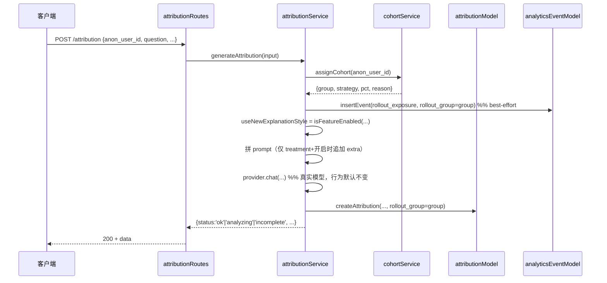

# K1.4 灰度 / 金丝雀发布机制设计

> 版本：v0.1 · 负责人：高见远（架构师） · 状态：设计 + 落地完成
> 关联：K1.3（盲评）/ K1.5（G1 闸门与晋级判据）
> 代码落点：`apps/api/src/config/rollout.ts`、`apps/api/src/services/rollout/cohortService.ts`、`apps/api/src/db/migrations/013_add_rollout_group.sql`

---

## 1. 目标与范围

把「新模型变体 / 新功能」安全地暴露给**一定比例的真实用户**，并在全量前用指标对比 **treatment vs control**（认可率 / 延迟 / 降级率），做到：

- **渐进放量**：1% → 5% → 20% → 50% → 100%，每一步都可观测、可回滚；
- **确定性分组**：同一用户始终落在同一组，对照组干净；
- **默认零影响**：`off` 为默认策略，运行期现有行为**完全不变**（安全红线）；
- **紧急熔断**：一个环境变量即可 100% 回退 control；
- **指标闭环**：按 cohort 落库，可直接 SQL 对比，喂给 K1.5 的 G1 闸门。

本机制**不下载任何模型权重、不修改 `aicorrection.db`、不破坏 `tsc`**。

---

## 2. 安全红线（硬约束）

| # | 约束 | 本设计如何满足 |
|---|------|----------------|
| R1 | 默认 `ROLLOUT_STRATEGY='off'` → 100% control | `getRolloutConfig()` 默认 `off`；`assignCohort` 在 `off` 下无条件返回 `control` |
| R2 | 绝不重复 `ALTER attributions` | 新列仅放在**新迁移 013**，且 attributions 只再加**一个** `rollout_group` 列；`analytics_events` 同样只加这一列 |
| R3 | 不下载、不改 db、不破坏 tsc | 纯代码 + 迁移文件；`npm run build -w @aicorrection/api` 通过（已验证） |
| R4 | 最小、可读、强类型，复用现有 env/types/analyticsEventModel 模式 | 复用 `env` / `insertEvent` / `generateEventId`；新增代码均为强类型 |

> 注：原任务建议迁移编号为 `010`，但仓库已有 `010_add_ugc_fields / 011_add_teaching / 012_add_question_snapshot`，为避免文件名冲突被迁移器跳过/覆盖，**实际命名为 `013_add_rollout_group.sql`**（按文件名排序，位于 012 之后，安全）。

---

## 3. 放量策略（Rollout Strategy）

由 `ROLLOUT_STRATEGY` 决定，三选一：

| 策略 | 取值 | 行为 | 典型用途 |
|------|------|------|----------|
| **off**（默认） | `off` | 100% control，运行期零变化 | 生产默认；新功能默认不可见 |
| **percentage** | `percentage` + `ROLLOUT_PCT=0..100` | `hash(anon_user_id) mod 100 < pct` → treatment，否则 control | 渐进放量（1/5/20/50/100%） |
| **cohort** | `cohort` + `ROLLOUT_COHORT_ALLOWLIST=csv` | 白名单内强制 treatment，名单外 control | 内部/种子用户先行体验 |

`pct` 越界会被 `clamp` 到 `[0,100]`；`pct=0` 等价于全 control，`pct=100` 等价于全 treatment。

---

## 4. 确定性、稳定的 Cohort 分配

核心保证：**同一 `anon_user_id` 永远落到同一组**（无随机、无时钟依赖）。

- 哈希：`FNV-1a 32-bit`（`fnv1a32`），纯函数、零依赖；
- 分桶：`bucket = fnv1a32(id) % 100` → 落在 `[0,100)`；
- 判定：`percentage` 下 `bucket < pct` 进 treatment；
- 空 `anon_user_id` → bucket 0（边界安全）。

分配优先级（与 `getRolloutConfig` 配合）：

```
1) kill-switch 置位        → control（最高优先级，立即熔断）
2) strategy = 'off'        → control（默认红线）
3) strategy = 'cohort'     → 白名单内 treatment，否则 control
4) strategy = 'percentage' → bucket < pct ? treatment : control
5) 兜底                   → control
```

> 确定性已单测覆盖（`cohortService.test.ts`）：9/9 通过，包括「同一用户两次分配同组」「pct 边界」「白名单」「kill-switch」。

---

## 5. control vs treatment 语义

| 维度 | control（对照） | treatment（实验） |
|------|----------------|------------------|
| 占比 | 100% − pct（或 0/100 取决于策略） | pct（percentage）/ 白名单命中（cohort） |
| 行为 | 现有生产行为，**永远不变** | 仅当某 feature-flag 显式开启且 `group==eligibleGroup` 时才可能改变 |
| 数据 | `rollout_group='control'` | `rollout_group='treatment'` |
| 目的 | 基线对照 | 实验新模型/新功能，量化对比 |

**关键原则**：对照组是「干净基线」。即便 treatment 组被放量，只要对应 feature-flag 没开，treatment 用户拿到的也是与 control **完全相同**的体验——这样 A/B 才有效。

---

## 6. Feature-Flag 门控（具体示例）

机制：`ROLLOUT_FEATURE_FLAGS` 注册表，每项含 `{ enabled, eligibleGroup, description }`。
判定 `isFeatureEnabled(featureId, cohort)`：**flag 未开 → false；开了但 `cohort.group != eligibleGroup` → false；开了且匹配 → true**。

### 示例功能：`newExplanationStyle`（新的「分步追问式讲解」风格）

- 注册：`ROLLOUT_FEATURE_FLAGS.newExplanationStyle = { enabled: env.ROLLOUT_FEAT_NEW_EXPLAIN, eligibleGroup: 'treatment' }`
- 开关：`ROLLOUT_FEAT_NEW_EXPLAIN`（默认 **false**，即默认关闭）
- 效果：开启后，**仅 treatment 组**在归因 system prompt 末尾追加「分步追问式讲解」指令；control 组无论开关都拿不到
- 安全：默认关闭 → 即使 treatment 组也看不到 → 运行期零行为变化

接入点（`attributionService.generateAttribution`）：

```ts
const cohort = assignCohort(input.anon_user_id);                 // 确定性分组
const useNewExplanationStyle = isFeatureEnabled('newExplanationStyle', cohort);
const systemExtra = useNewExplanationStyle
  ? '\n\n【讲解风格实验·treatment】请采用"分步追问式"讲解：…引导式追问…'
  : '';                                                          // 默认空 → 零影响
const messages = [{ role: 'system', content: systemBase + refsBlock + systemExtra }, ...];
```

> 后续新增实验（如候选模型变体）只需在 `ROLLOUT_FEATURE_FLAGS` 加一项并复用 `isFeatureEnabled` 门控，无需改架构。

---

## 7. Kill-Switch 紧急熔断

环境变量 `ROLLOUT_KILL_SWITCH='1'`（或 `true`）→ `getRolloutConfig()` 把 `strategy` 强制回落 `'off'`，`assignCohort` 直接返回 `{ group:'control', strategy:'off', reason:'kill_switch' }`。

- 优先级**高于一切**策略与百分比；
- `ROLLOUT_KILL_SWITCH` 由 `getRolloutConfig()` 动态读 `process.env`，运行时置 `1` 即时熔断、无需重启；其余 `ROLLOUT_*` 由 env 模块加载时快照，改动需重启进程生效；
- 一旦置位：100% 流量回归 control，**无需回滚代码或迁移**。

---

## 8. 按 Cohort 的指标采集

两处落 `rollout_group`，使 treatment 能在全量前与 control 对比：

1. **`attributions.rollout_group`**（每条归因结论自带分组）→ 认可率、延迟、降级率可直接按组切片；
2. **`analytics_events.rollout_group` + `rollout_exposure` 事件**（仅 `strategy≠'off'` 时，每条归因尝试发一次曝光；默认 `off` 下不发曝光、`analytics_events` 零新增）→ 曝光漏斗、功能命中分布。

### 示例对比 SQL（喂给 K1.5 G1 闸门）

```sql
-- 认可率 by 组（rate_action 非空才计入）
SELECT rollout_group,
       COUNT(*) AS total,
       SUM(CASE WHEN rate_action='approve' THEN 1 ELSE 0 END) AS approved,
       ROUND(100.0*SUM(CASE WHEN rate_action='approve' THEN 1 ELSE 0 END)/COUNT(*),2) AS approve_rate
FROM attributions
WHERE rate_action IS NOT NULL
GROUP BY rollout_group;

-- 延迟 by 组（P95 / 均值）
SELECT rollout_group,
       COUNT(*) AS n,
       AVG(attr_latency_ms) AS avg_ms,
       MAX(attr_latency_ms) AS max_ms
FROM attributions
WHERE attr_latency_ms IS NOT NULL
GROUP BY rollout_group;

-- 曝光漏斗 by 组
SELECT rollout_group, COUNT(*) AS exposures
FROM analytics_events
WHERE event_name='rollout_exposure'
GROUP BY rollout_group;
```

> `trackingService.ingest` 也会按 `anon_user_id` 服务端推导 `rollout_group` 写入所有埋点事件，使 loop_upload / verify 等漏斗事件同样可按 cohort 切片（默认 `off` 下恒为 `control`，与 NOT NULL 默认值一致，零行为变化）。

---

## 9. 分阶段放量计划 + 与 G1 闸门（K1.5）挂钩

每一步放量前先看上一步的 cohort 指标；晋级/回滚判据直接对接 **K1.5 的 G1 闸门**（非劣化判定）。

| 阶段 | 策略 | pct / 名单 | 最小观察 | 晋级条件（vs control，对接 G1） | 回滚条件 |
|------|------|-----------|----------|-------------------------------|----------|
| 0 默认 | `off` | — | — | 生产基线 | — |
| 1 影子 | `percentage` | 1% | ≥48h 且 ≥200 样本 | 无显著劣化 | 任一护栏触发 |
| 2 | `percentage` | 5% | ≥48h | 认可率非劣（treatment ≥ control − 2pp）且延迟 P95 ≤ control×1.10 且降级率 ≤ control | 同上 |
| 3 | `percentage` | 20% | ≥72h | 同上，且样本量充足 | 同上 |
| 4 | `percentage` | 50% | ≥72h | 同上 | 同上 |
| 5 全量 | `percentage` | 100%（长期稳定后可将功能设为默认并移除 flag） | 持续 | 稳定后转正 | `kill-switch` 兜底 |

**晋级 / 回滚判据（对齐 K1.5 G1）**：
- **非劣化主指标**：treatment 认可率 ≥ control − δ（δ 建议 2 个百分点）；
- **护栏指标**：treatment 延迟 P95 ≤ control × 1.10；treatment 降级率（`analyzing`/`incomplete`）≤ control；
- 任一护栏在观察窗内被突破 → 立即回滚到上一阶段（或 `kill-switch` 直接 100% control）；
- 达到 100% 且稳定 ≥ 1 周 → 把对应 feature 固化为默认行为，并关闭 flag 路径。

---

## 10. 失败模式与护栏

| 失败模式 | 护栏 |
|----------|------|
| 迁移 `duplicate column` 中断 | 单列新增 + 新迁移 013，绝不重复 `ALTER attributions`（R2） |
| 默认行为被悄悄改变 | 红线 `off` 默认；`newExplanationStyle` 默认关闭；单测覆盖 `off→control` |
| treatment 误改真实模型行为 | 示例功能默认关闭；开启后仅 treatment 命中 |
| 放量失控 / 线上事故 | `ROLLOUT_KILL_SWITCH='1'` 即时 100% 回退，无需回滚代码 |
| 埋点写入失败拖垮主流程 | `emitRolloutExposure` 全程 `try/catch`，失败不影响归因 |
| 分组漂移（同用户跨会话不同组） | 确定性 `FNV-1a` 哈希，无随机/时钟，稳定 |
| `pct` 配置错误（越界/负数） | `getRolloutConfig` 内 `clamp` 到 `[0,100]` |
| 哈希碰撞 | 统计均匀即可，非安全敏感；分组用于 A/B，不影响正确性 |

---

## 11. 数据 Schema 变更（Migration 013）

```sql
ALTER TABLE attributions
  ADD COLUMN rollout_group TEXT NOT NULL DEFAULT 'control'
  CHECK (rollout_group IN ('control', 'treatment'));

ALTER TABLE analytics_events
  ADD COLUMN rollout_group TEXT NOT NULL DEFAULT 'control'
  CHECK (rollout_group IN ('control', 'treatment'));

CREATE INDEX IF NOT EXISTS idx_attr_rollout_group   ON attributions(rollout_group);
CREATE INDEX IF NOT EXISTS idx_events_rollout_group ON analytics_events(rollout_group);
```

- 旧数据（迁移前）因 `NOT NULL DEFAULT 'control'` 自动归为 control，**无需回填**；
- 迁移幂等（`_migrations` 表按文件名记录，不会重复执行）；
- 启动时由 `runMigrations(db)` 自动应用（不改 `aicorrection.db` 文件本身）。

---

## 12. 代码落点（接入点）

| 文件 | 作用 |
|------|------|
| `apps/api/src/config/env.ts` | 新增 `ROLLOUT_*` 环境变量（带类型，默认 `off`/关闭） |
| `apps/api/src/config/rollout.ts` | `getRolloutConfig()`、`ROLLOUT_FEATURE_FLAGS`、`isFeatureEnabled()` |
| `apps/api/src/services/rollout/cohortService.ts` | `assignCohort()` / `fnv1a32()` / `bucketOf()`（纯函数，可单测） |
| `apps/api/src/db/migrations/013_add_rollout_group.sql` | 两表各加 `rollout_group` 列 + 索引 |
| `packages/shared/src/types.ts` | `Attribution` / `AnalyticsEvent` 增加 `rollout_group: RolloutGroup` |
| `apps/api/src/models/attributionModel.ts` | `createAttribution` INSERT 写入 `rollout_group` |
| `apps/api/src/models/analyticsEventModel.ts` | `insertEvent` INSERT 写入 `rollout_group` |
| `apps/api/src/services/tracking/trackingService.ts` | 埋点事件按 `anon_user_id` 推导并写入 `rollout_group` |
| `apps/api/src/services/attribution/attributionService.ts` | 入口处 `assignCohort` + 发 `rollout_exposure` + feature 门控 prompt + 写 `rollout_group` |

### 时序图（归因入口的灰度接入）



---

## 13. 验证 / QA 任务清单（有序、带依赖）

> 给后续验证 / QA 使用。T0 为前置，其余可并行。

- **T0（前置）**：`npm run build:shared` 重建 shared 类型（新增 `RolloutGroup`/字段）。
  - 依赖：无 · 优先级 P0
- **T1**：`npm run build -w @aicorrection/api` 通过（已验证通过）。
  - 依赖：T0 · 优先级 P0
- **T2**：运行单测 `npm run test -w @aicorrection/api`（含 `cohortService.test.ts`），9/9 通过（已验证）。
  - 依赖：T1 · 优先级 P0
- **T3**：启动 API，`runMigrations` 自动应用 013；确认 `attributions` / `analytics_events` 新增 `rollout_group` 列且旧行默认 `'control'`（不手动改 db）。
  - 依赖：T1 · 优先级 P0
- **T4**：默认 `off` 烟雾测试：发起若干归因，断言 (a) 返回结构与现有一致；(b) `attributions.rollout_group='control'`；(c) off 下不应有任何 `rollout_exposure`（`analytics_events` 零新增）；(d) `newExplanationStyle` 未生效（prompt 无 extra）。
  - 依赖：T3 · 优先级 P1
- **T5**：`percentage` 验证：设 `ROLLOUT_STRATEGY=percentage`、`ROLLOUT_PCT=50`，用固定 `anon_user_id` 多次归因，断言分组稳定且约半数落 treatment；SQL 对比两组认可率/延迟。
  - 依赖：T3 · 优先级 P1
- **T6**：`cohort` 白名单验证：设 `ROLLOUT_COHORT_ALLOWLIST=u_vip`，断言 `u_vip`→treatment、其它→control。
  - 依赖：T3 · 优先级 P1
- **T7**：kill-switch 验证：任意策略下置 `ROLLOUT_KILL_SWITCH=1`，断言全部回归 control、`reason='kill_switch'`。
  - 依赖：T3 · 优先级 P0（安全）
- **T8**：feature-flag 验证：设 `ROLLOUT_FEAT_NEW_EXPLAIN=1` 且仅 `percentage` 命中 treatment，断言仅 treatment 组 prompt 含「分步追问式」、control 组不含。
  - 依赖：T5 · 优先级 P2
- **T9**：指标闭环验证：执行 §8 的对比 SQL，确认 treatment/control 两行可分别聚合，喂给 K1.5 G1 闸门。
  - 依赖：T4–T8 · 优先级 P1

---

## 14. 设计决策要点摘要

1. **编号 013 而非 010**：避免与既有迁移冲突，按文件名排序安全接入。
2. **单列最小变更**：attributions / analytics_events 各只加一个 `rollout_group`，不触碰既有列（R2）。
3. **确定性哈希**：`FNV-1a 32-bit mod 100`，纯函数可单测，无随机/时钟依赖。
4. **默认零影响**：`off` + 示例功能默认关闭，运行期行为完全不变（R1）。
5. **熔断优先**：`kill-switch` 高于一切策略，即时 100% 回退。
6. **指标可对比**：分组随归因行与埋点事件落库，SQL 即可 treatment vs control 对比，直接对接 K1.5 G1。

---

## 15. 放量就绪修复（数据可信度，K1.4 合入后增量）

> 动机：QA 独立验证（`IS_PASS: YES`）确认分组逻辑本身无 Bug，但指出 3 条会在**真正放量时让分组数据失真**的口径缺口。这些不是分组算法缺陷，而是「归因链路」与「埋点链路」的元数据不同源。本节记录修复，使 K1.4 从「能编译」推进到「放量数据可用」。

### 15.1 三条修复

| # | 缺陷 | 修法 | 落点 |
|---|---|---|---|
| 1 (P1) | `is_internal` 不同源：曝光/归因由 `metadataMiddleware` 按回环 IP / 白名单判定（本机=1），展示/评价只信前端 `ctx.is_internal`（`buildContext` 不产出 → 恒 0）。`WHERE is_internal=0` 会只过滤曝光，切断 K1.5 §5.3-C 漏斗 | 全局中间件算出的 `req.is_internal` 由埋点路由作为 `serverMeta` 传入 `ingest()`，服务端判定覆盖前端标记；不传 `serverMeta` 时回落原行为（向后兼容） | `trackingRoutes.ts`、`trackingService.ts`（新增 `IngestServerMeta`） |
| 2 (P2) | 曝光事件 `is_mock` 硬编码 0，`attributions.is_mock` 动态，Mock 归因 / runtime fallback 下跨段拼接错配 | 曝光入口按 `provider.name === 'mock'` 打初值；归因结果确定后 `alignExposureMockFlag()` 调新增的 `markExposureMockFlag()` 对齐该 `(user, loop)` 的曝光标记（幂等，off 下影响 0 行） | `attributionService.ts`、`analyticsEventModel.ts` |
| 3 (P2) | 分组漂移：`trackingContext` 是模块级内存态，刷新页面重置为 `user_id=''`，而 `anonUserId` 从 localStorage 恢复 → 原代码只在新建账户分支 `setUser`，后续埋点带空 id，`assignCohort('')` 可能把同一 loop 拆两组 | `ensureAccount()` 无论 uid 来自新建还是本地恢复，每次都重新 `tracker.setUser(uid, seg)` | `apps/web/src/hooks/useLoop.ts` |

### 15.2 验证证据

- **构建**：`build:shared` / `build -w @aicorrection/api` / `typecheck -w @aicorrection/web` 全部 exit 0。
- **单测**：新增 `trackingService.test.ts` 7 项（服务端判定双向覆盖、无 serverMeta 向后兼容、分组确定性、幂等去重、曝光 mock 标记只影响指定 `(user,loop)`、三类事件同源）；全量 `npm run test -w @aicorrection/api` **48/48 pass**，3.7s 退出、不挂起、不打开生产库。
- **真实 HTTP 端到端**（隔离临时库 + 独立端口 3999、`LLM_PROVIDER=mock`、`ROLLOUT=percentage/100`）：`loop_upload` / `loop_attr_show` / `attr_rate` 三条埋点**不带** `is_internal`，服务端仍全部落 `1`；`rollout_exposure` 与 `attributions` 的 `is_internal=1`、`is_mock=1` 完全一致；全链 `rollout_group='treatment'`；曝光恰好 1 条（默认 off 守卫未破坏）。**5/5 PASS**。
- **生产库**：`aicorrection.db` 主库 / `-wal` mtime 未变，全程只读确认；验证库与临时脚本用完即删。

### 15.3 仍然存在的边界（非本轮范围）

- 认可率所需的真实用户样本 **n≥250** 必须靠灰度放量获得，本机无法制造；默认 `off` 下所有历史行仍为 `control`，不能据分组 SQL 下 GO/NO-GO（见 K1.5 §5.3 解读约束第 1 条）。
- `p50≤30s` 在离线单机 8GB 真实 27B（≈110s）下仍是 **OPEN BLOCKER**（K1.5 §4），属部署/硬件约束，不是分组或埋点代码问题。
- 放量前仍建议跑空 `anon_user_id` 预检 SQL，防御旧版本前端缓存或非标准客户端（K1.5 附录 C 步骤 6）。
